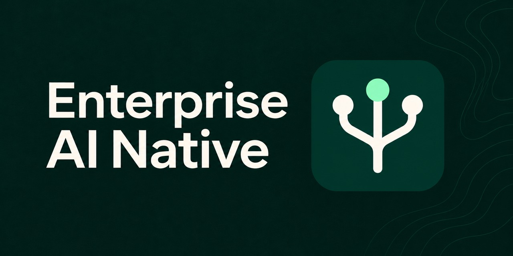
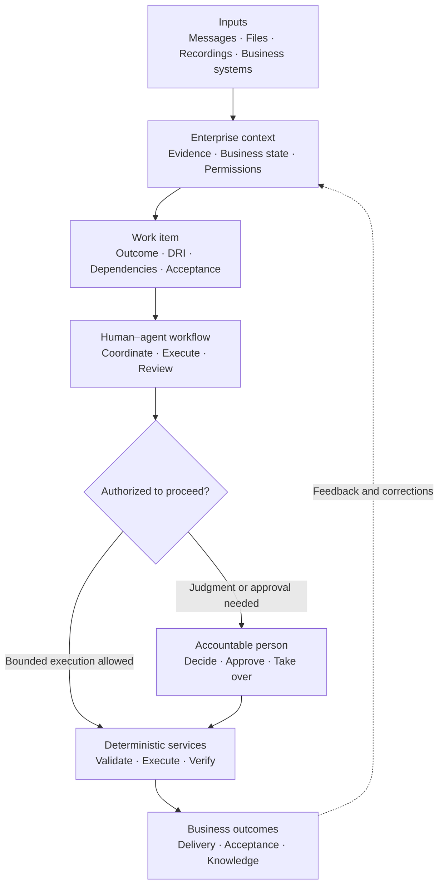

  

<h1 align="center">Enterprise AI Native</h1>

<strong>A shared workspace for people, AI agents, and business systems</strong>

  <a href="README.md">简体中文</a> · English
  &nbsp; | &nbsp; <a href="docs/01-愿景与定位/项目完整构想.md">Project vision</a>
  &nbsp; · &nbsp; <a href="SOURCE_OF_TRUTH.md">Documentation</a>

---

Enterprise AI Native aims to **organize people, AI agents, and business systems around accountable work and measurable business outcomes**. Instead of attaching a chatbot to every existing job, it designs collaboration around the goals, permissions, context, owners, and acceptance criteria of each work item.

Agents may execute asynchronously and coordinate work across roles within authorized boundaries. People remain accountable for business outcomes, consequential judgment, approvals, and exceptions; systems of record remain authoritative. The [task-centered organization design](docs/02-架构与方法/任务中心的人机协作与组织设计.md) outlines this long-term vision and its assumptions.

## Core design

| Capability | How it works |
| --- | --- |
| **Project-centered intake** | Connect messages, documents, recordings, ERP, and office systems. Associate original materials, sources, and versions with the work they support. |
| **Task-centered human–agent collaboration** | Each work item has a human DRI, contributors, authorized agent/service nodes, permissions, and acceptance criteria. Agents may assist individuals or coordinate work between roles. |
| **Accountability and controlled action** | People remain accountable. Agents escalate conflicts, consequential decisions, and actions requiring approval; authorized execution is verified against business records. |
| **Organizational knowledge** | Keep original evidence, decisions, and corrections available so the next team can trace how a conclusion was reached and reuse the latest guidance. |

## From information to outcomes

Projects and shared knowledge form the common foundation. Feishu, WeChat, WeCom, and existing enterprise systems can connect through their own channels. The design can use [DeepSeek Harness](https://github.com/deepseek-ai/deepseek-harness) for agent execution, [Paperclip](https://github.com/paperclipai/paperclip) for task orchestration, and [WeKnora](https://github.com/Tencent/WeKnora) for knowledge retrieval.

## A customer inquiry, from intake to acceptance

1. **Intake.** A customer sends a request for a quote and a colleague adds site photos in chat. Both are attached to the same project with their sources.
2. **Collaboration.** The coordination agent assigns document checks and quote preparation. The review agent spots a mismatch in the specifications and requests a revision with the original evidence.
3. **Decision.** The project owner confirms the scope and delivery criteria. Agents use that decision to complete a deliverable the team can review.
4. **Knowledge.** Acceptance, corrected guidance, and supporting evidence become part of the project record for the next inquiry.

This approach can also be applied to bidding, project documentation, delivery, expense claims, and equipment or inventory management. Start with a workflow that takes time away from the team, then connect the systems and knowledge that support it.

## Start here

| Explore | Read |
| --- | --- |
| How the pieces fit together | [Project vision](docs/01-愿景与定位/项目完整构想.md) |
| How work reorganizes human–agent collaboration | [Task-centered organization design](docs/02-架构与方法/任务中心的人机协作与组织设计.md) (Chinese) |
| Shared context and collaboration architecture | [Kernel and enterprise context](docs/02-架构与方法/Kernel与企业Context分层.md) |
| How to choose and improve the first workflow | [Scenario selection](docs/04-场景与实践/行业场景与机会筛选.md) · [Implementation plan](docs/plans/2026-11-04-project-plan-v0.2.md) |
| The ideas and cases behind the project | [AI Native Company research](docs/research/2026-11-03-anc-report.md) · [HA7CH research](docs/research/2026-11-03-ha7ch-report.md) |

  <a href="SOURCE_OF_TRUTH.md">All documentation</a> · <a href="LICENSE">CC BY-NC 4.0</a> · <a href="RIGHTS.md">Rights and attribution</a>

