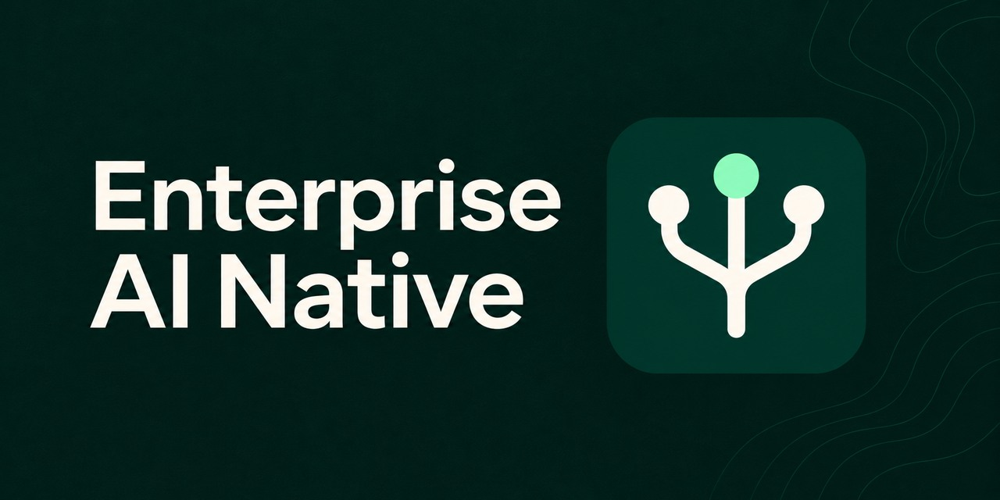
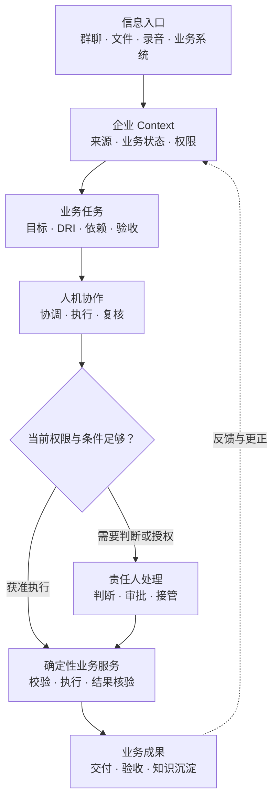

  

<h1 align="center">企业 AI Native</h1>

<strong>让人、AI Agent 和企业系统围绕同一项工作协作</strong>

  简体中文 · <a href="README.en.md">English</a>
  &nbsp; | &nbsp; <a href="docs/01-愿景与定位/项目完整构想.md">项目构想</a>
  &nbsp; · &nbsp; <a href="SOURCE_OF_TRUTH.md">文档导航</a>

---

企业 AI Native 的长期目标，是**以业务任务和价值交付为中心组织人、AI Agent 与企业系统**。它不只是给既有岗位配一个助手，而是让每项工作在明确责任、权限、上下文和验收标准的前提下，由合适的人机节点协作完成。

在具体流程中，Agent 可以承担获准的异步执行与跨岗位协调；人保留目标、关键判断、授权、异常处理和结果责任。现有业务系统保留正式记录，工作反馈回到企业 Context。详见[任务中心的人机协作与组织设计](docs/02-架构与方法/任务中心的人机协作与组织设计.md)；具体效果仍需验证。

## 核心设计

| 能力 | 工作方式 |
| --- | --- |
| **信息汇入同一项目** | 从群聊、文件、录音和 ERP、OA 等入口获取资料，把原件、来源和版本关联到对应工作。 |
| **按任务组织人机协作** | 为每项交付明确 DRI、IC、执行节点、权限和验收标准；既支持个人 AI 辅助，也支持 Agent 在岗位之间协调与异步推进。 |
| **责任与受控行动** | 人对业务结果负责；缺件、冲突、高风险动作和正式承诺转交有权人员复核与审批，获准执行后还须核验结果。 |
| **把成果变成组织知识** | 保留原件、决策和更正记录，让接手的人查得回去，让下一次协作能用上最新结论。 |

## 信息怎样变成成果

项目和企业知识是这套架构的公共基础，飞书、微信、企业微信及已有业务系统可以通过各自的入口接入。协作层可以组合 [DeepSeek Harness](https://github.com/deepseek-ai/deepseek-harness)、[Paperclip](https://github.com/paperclipai/paperclip) 和 [WeKnora](https://github.com/Tencent/WeKnora)，分别承担 Agent 工作、任务调度和知识检索。

## 用一笔客户询价理解它

1. **收件。** 客户发来询价单，员工在群里补充现场照片。材料关联到同一个项目，并保留来源。
2. **协作。** 协调 Agent 把资料核对和报价准备分给不同岗位。复核 Agent 发现规格冲突，带着原文发起返工。
3. **确认。** 负责人拍板业务范围和交付口径，Agent 依据确认结果继续整理，形成可检查的交付件。
4. **沉淀。** 验收结论、更正后的规则和原始依据进入项目记录，下次碰到同类业务时可以直接查询和复用。

同一种工作方式可用来设计招投标、项目资料管理、项目交付、报销、物资与设备管理。从企业眼下最耗时间的一条流程开始，逐步连接已有系统和组织知识。

## 从这里开始

| 想了解 | 阅读入口 |
| --- | --- |
| 整套方案如何运转 | [项目完整构想](docs/01-愿景与定位/项目完整构想.md) |
| 人与 Agent 应如何重新组织工作 | [任务中心的人机协作与组织设计](docs/02-架构与方法/任务中心的人机协作与组织设计.md) |
| 如何搭建数据与协作底座 | [Kernel 与企业上下文](docs/02-架构与方法/Kernel与企业Context分层.md) |
| 如何选场景、做出第一个改善 | [场景筛选](docs/04-场景与实践/行业场景与机会筛选.md) · [实施方案](docs/plans/2026-11-04-project-plan-v0.2.md) |
| 理念与案例从哪里来 | [AI Native Company 研究](docs/research/2026-11-03-anc-report.md) · [HA7CH 专题](docs/research/2026-11-03-ha7ch-report.md) |

  <a href="SOURCE_OF_TRUTH.md">全部文档</a> · <a href="LICENSE">CC BY-NC 4.0</a> · <a href="RIGHTS.md">权利与署名</a>

