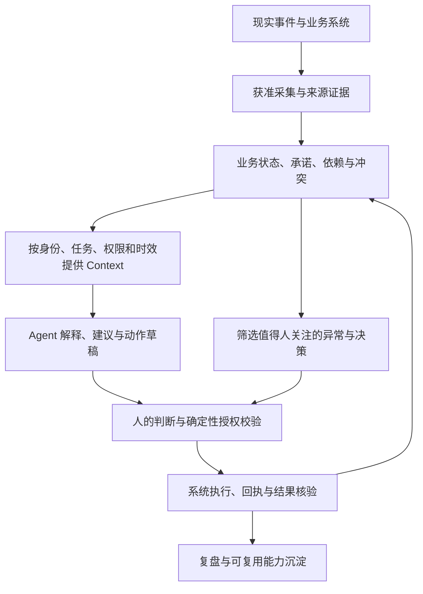

# 企业 AI Native 改造：项目完整构想

版本：整合稿 v0.2。日期：2026-11-04。状态：基于历史知识库、ANC 与 HA7CH 研究的综合方案；其中长期架构、产品形式和商业判断仍需验证。明确授权与假设见[状态登记](../06-决策与研究/整合决策与待验证假设.md)。

## 1. 我们整体要做什么

**让 AI 在授权范围内持续理解企业的业务状态，帮助人与系统协调工作，并把获准的工作推进到可核验的完成态。**

“企业通用”指能够跨企业复用的方法与基础能力。具体交付仍需尊重行业语义、企业规则、岗位责任和现有系统；跨行业通用程度本身也是待验证问题。

企业里需要长期维护的，不只是资料，还有“目前发生了什么、谁承诺了什么、依赖谁、何时到期、哪里冲突、谁能决定、怎样才算完成”。我们希望把这些信息转成有来源、时效、权限与责任的业务 Context，让 AI 在任务中取得必要背景，让人看到真正需要自己判断的事项。

三组资料分别补齐了这个构想：

| 输入 | 对项目的贡献 | 需要保留的边界 |
|---|---|---|
| ANC 研究 | 从流程、组织、知识、责任和经济性重做工作方式，用业务结果评价改造 | 案例多含企业自报，不能直接移植其收益 |
| HA7CH 研究 | 深入现场发现问题，共享企业知识，缩短反馈循环，把一次交付沉淀成下一次能力 | 理念、公开代码与可商用成熟度分开；现场节奏不是承诺 |
| 历史长期研究 | 企业运行时、Context/Attention、岗位连续性、共享能力与受控行动 | 架构与网络设想没有被实现或验证 |

近期通过实际流程交付验证价值，长期根据重复出现的问题决定应形成什么产品。FDE 是进入现场的一种交付方式，不能预先限定终局只能是咨询服务；企业 Runtime 也是候选方向，不能预先当成已经成立的平台。

依据：[ANC 研究](../research/2026-11-03-anc-report.md)、[HA7CH 研究](../research/2026-11-03-ha7ch-report.md)、[历史愿景](愿景定位与项目边界.md)。

### 对 HA7CH 理念的具体取舍

- 采用 Echo 与 Delta 的现场思路：先复述并核实企业真实问题，再展示工作方式可以发生的具体改变。以一张流程全景图和一个真实任务演示辅助 GO/HOLD/NO-GO 判断。
- 采用共享企业知识与经审阅的方法沉淀：事实指向明确权威记录，Skills/模板保留版本、适用条件与反馈；现场修正不直接变成全企业规则。
- “零 Token”区分两件事：让客户已有 Agent 承担推理，以及检索侧减少不必要推理。两者都要核算完整任务、人工与运维成本。
- “0 中层”用于检验信息搬运和协调环节能否被可靠承接；战略、授权、培养、冲突处理与风险责任仍需明确承担。不能把减少管理人数作为默认目标。
- 保留客户对环境、数据和退出的控制。公开轻量实现、规划中的工具链与生产能力分别评价；采用代码前仍需版本、许可、权限和实际运行核验。

## 2. 完整工作闭环

现有 ERP、CRM、OA、IM、表格、邮件和文档是信息入口，也可能是执行端。它们的权威状态由企业明确指定。模型会话、搜索索引和知识文件不能自动替代订单、库存、审批或正式承诺的记录。

AI 的输出可能是解释、候选事实、建议或草稿。正式写入由确定性业务服务检查身份、权限、规则、对象版本和必要批准；执行后还要核验结果。调用工具成功不等于业务已经完成。

## 3. Context 的核心是正在发生的业务

Context 应按实际需要表达对象、事件、状态、责任、期限、依赖、规则、来源和有效时间。优先维护需要跟进的未闭环事项，而非追求收集全部信息。

| 内容 | 处理方式 |
|---|---|
| 原始邮件、消息、附件或系统记录 | 保留来源、采集权限、时间及版本，作为证据 |
| 某人的陈述或模型抽取 | 标为来源主张或候选观察，等待必要确认 |
| 已确认业务事实 | 指明权威记录与有效时间，可追溯修正 |
| 由事实计算的信号 | 保留规则、输入和计算时间，可重算 |
| AI 推断与建议 | 明示不确定性，不冒充组织决定 |

同一事项出现多个说法时展示冲突、适用时间与责任人。系统需要知道“谁说的、何时有效、谁有权确认”，而非简单采用最新一条消息。

知识文件适合制度、术语和稳定操作方法；交易状态、长任务、审批与执行记录需要状态管理。任务执行期间应固定所用规则版本，规则更新不能悄悄改变进行中的任务。完成态需有验收者、回执或其他业务证据。

依据：[Context 治理](../03-知识与治理/知识权限与Context治理.md)、[技术原则](../02-架构与方法/技术方法论与选型原则.md)、[HA7CH 现场修正研究](../research/2026-11-03-ha7ch-report.md)。

## 4. 可复用能力怎样分层

| 层次 | 承担什么 | 如何判断边界 |
|---|---|---|
| Shared Capabilities | OCR、ASR、解析、转换、搜索、报表、模型与连接器 | 可替换工具，不负责最终业务授权 |
| 通用 Kernel / Runtime | 稳定对象/事件契约、来源与时间、权限、任务状态、审计及投影接口 | 由重复工作提炼，避免提前建万能系统 |
| 行业 Domain Pack | 行业术语、对象扩展、常见流程、规则和评价样本 | 需要同类案例验证共性与例外 |
| 企业 Context 与配置 | 本企业的事实、制度、角色、系统映射、审批链与本地规则 | 客户隔离；明确所有权、更新者与退出方式 |
| 交付与内部资产 | 经授权可复用的模板、工具、评价集、操作手册和改进经验 | 不带走客户秘密或未经许可的知识产权 |

Agent、模型、API、MCP 和 Skill 都可以成为接入方式。潜在持久资产是可信业务状态、领域语义、评价与交付经验；这些是否形成商业壁垒，需要真实客户和成本证据。

每完成一次交付，都要回答：这是企业特例、行业共性、跨行业能力，还是基础工具？第二家企业的实施与维护工时是否下降，是验证复用的关键。增加模块数量本身不能证明产品化。

依据：[分层架构](../02-架构与方法/Kernel与企业Context分层.md)、[商业与交付沉淀](../05-商业与市场/商业化增长与交付沉淀.md)。

## 5. 人、岗位、组织如何连接

三类 Context 可以有授权连接，但不合并所有权：

- Personal：个人偏好、私人生活、个人可携带经验及注意力规则。
- Role：岗位责任、获准业务状态、工作成果、承诺、权限与交接。
- Organization：组织制度、主数据、正式业务记录与治理规则。

岗位可持续存在，人会流动。入职建立必要连接，调岗或离职撤销相应权限，并交接岗位的正式工作；员工的私人笔记、全部 AI 聊天和前公司的业务资料不会自然成为新组织资产。

“每人一个 Bot”可作为试验形式，也可以按岗位、团队或工作流提供入口。应由任务、权限和成本决定，不能把 Bot 数量当作改造成效。

## 6. 两种调度与实际体验

**Context Scheduler**回答“这个 Agent 为当前任务需要知道什么”：按身份、目的、权限、时效和相关性选择必要背景。

**Attention Scheduler**回答“什么事情值得现在交给人”：识别逾期、冲突、关键变化、需要判断或批准的事项，控制误报、重复提醒与打断。安静地正确完成工作也可以是成功。

用户可以表达意图，也需要查看结构化工作台、对象状态、时间线、证据、批量审核与恢复入口。对话适合表达意图；结构化视图适合比较和承担责任。报告应从可信状态投影产生。

近期可用简单规则处理到期与异常，双调度的长期研究不要求先建完整调度平台。协作优先依托有权限的文档、工单、邮件与日历等共享产物。弱信号即使不含正文，也可能暴露关系、存在性与频率，仍需独立治理。

依据：[Attention 与网络研究](../03-知识与治理/Attention与Context网络研究.md)。

## 7. 两类企业进入方式

**存量企业（Brownfield）：** 在现有系统上方连接必要事实和工作流。先查清谁负责哪种状态，解决重复录入、交接、遗漏和跨系统协调，尊重既有系统的正式记录。

**新建工作系统（Greenfield）：** 从自然语言意图与结构化业务视图组织体验，底层仍维护数据库、事件、证据与确定性规则。是否需要新建系统，要由现有工具无法满足的实际需求证明。

采用路径也有两种候选：由组织授权进入特定业务流程；或从单个用户独立有效的工具出发，再逐步形成明确授权的小范围协作。后者不能跳过组织准入、数据权利与采购要求。

首个行业、进入方式和产品界面均未决定。

## 8. 用一个工作场景检查构想

以下是说明机制的假设案例，尚未选为 MVP：客户提出变更交期，销售、采购和交付之间需要协调。

1. 从获准渠道获得变更消息，关联订单与原计划，保留原文和时间。
2. 客户请求先作为待确认主张。正式订单尚未变更时，明确显示两种状态及差异。
3. 找到依赖的采购、库存与排产记录；信息不足就列出缺口，不能编造交期。
4. AI 给业务负责人准备影响说明、所需确认和回复草稿；提醒只发给有责任与权限的人。
5. 负责人批准具体对象、版本和动作。业务服务重新检查权限及状态，再更新允许更新的系统；外部承诺需单独具备授权。
6. 收到执行回执，验证订单与相关任务是否一致；部分失败时明确剩余事项、补偿和责任。
7. 记录交付时长、遗漏、纠错、打扰、维护和实际成本，把经审阅的规则改进纳入下一轮。

这个例子同时检验 Context、跨岗位协作、注意力、受控执行和结果核验。若简单表格或规则已经解决问题，就用较简单的方案。

## 9. 商业构想与能力增长

近期建议以现场发现和流程改造形成可验收交付；是否收费诊断、按项目交付、持续维护或订阅，需验证实际采购链与成本。

增长应来自更多有价值的工作、岗位和系统接入，以及客户可确认的改进。先让问题与状态可见，再协同，再受控自动化，最后持续优化。价值衡量可以接近完成工作或业务结果；计费单位仍要考虑归因、审计、预算和供应成本，不能直接套用收益分成。

长期可能形成垂直软件、跨行业 Context/协调产品、交付平台或这些形式的组合。比较标准是用户购买理由、重复交付成本、持续使用和退出能力，而非预设某个产品名称。HA7CH 关于资本或组织形态的远期推演，当前不列入核心落地阶段。

## 10. 逐步落地，而非一次建设全部构想

| 层级 | 要证明什么 | 前进条件 |
|---|---|---|
| 第一条真实工作流 | 有具体用户、痛点、合法材料、责任和完成标准 | 相对现有办法产生可核验净价值 |
| 来源到状态的只读/草稿闭环 | 正确理解并减少寻找、转述与遗漏 | 来源、纠错、隔离、人工负担与成本可接受 |
| 获准的受控执行 | 权限与批准能够约束动作并验证结果 | 幂等、撤权、故障与恢复有效 |
| 第二组织或相似场景 | 哪些能力确实复用 | 实施/维护成本下降，无客户信息串用 |
| 产品化与规模治理 | 哪种产品形态与服务边界成立 | 购买、持续使用、可靠性与单位经济性证据 |
| 多节点网络与组织演化 | 联邦协作是否带来额外价值 | 独立研究授权与隐私、成本、退出验证 |

各层不意味着固定开发顺序。第二场景可先复用只读能力；不必为了复用而先获得自动执行权限。详细阶段与停止条件见[整体方案 v0.2](../plans/2026-11-04-project-plan-v0.2.md)。

## 11. 当前构想的边界与关键未知

已明确的是企业通用 AI Native 改造方向，以及先研究、整理、再决定实施。尚未决定首个企业、工作流、技术栈、部署、价格和最终产品形态。2026-11-06 补充：公开版范围限于通用研究文档，有权许可的原创内容采用 CC BY-NC 4.0；其他事项不因此确定。

当前最大依赖是真实业务入口与授权材料。关键风险是“理解正确但无权行动”“局部提效但端到端负担增加”“第一家能做但第二家仍需重写”。这些风险必须通过基线、固定任务、失败案例与实际工时来判断。

历史教育项目仅提供方法参考，其代码、R1 验收和测试不证明本项目已经实现。跨 Context 联邦、Role Agent、组织涌现与自动外发也没有因为出现在构想中而获准实施。完整来源路由见[文档导航](../../SOURCE_OF_TRUTH.md)。
