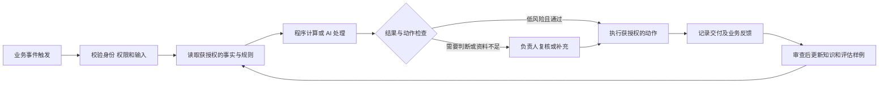

# AI Native Company 理念 案例与企业通用改造研究报告

研究日期：2026 年 11 月 3 日。版本：1.0。对象：企业 AI Native 改造项目负责人、业务负责人和技术负责人。

专题补充：[HA7CH 理念与企业 AI Native 改造研究](2026-11-03-ha7ch-report.md)，基于其公开 GitHub 源码、课程与文章，进一步讨论现场交付、知识与任务状态、组织主张及实现边界。

本报告采用项目约定，将 AI Native Company 缩写为 ANC。讨论重点是企业如何重新安排工作、知识、系统和责任，使 AI 持续参与经营。案例覆盖欧美、日本和中国，包括 10 个主要企业案例和 1 个国内早期观察样本。它们处于不同改造阶段，不构成“已经完成 ANC 转型”的认证名单。

## 1 核心判断

**这个项目适合建设一套可复制的企业改造方法：识别经营问题，重画业务流程，接通知识和系统，明确人机分工，以真实结果验收，再向相邻流程扩展。** 通用性来自共用的改造步骤、控制能力和交付模板；具体企业仍须配置自己的事实、规则、权限与验收标准。

本轮研究形成六项判断：

1. **ANC 应以经营方式定义。** 一家公司的产品可以依赖 AI，但内部管理仍沿用传统流程；员工普遍使用聊天工具，也不能据此判断企业已完成经营重构。需要进一步检查核心任务、系统动作、决策责任与反馈是否发生变化。
2. **改造的基本单位应是有起止点的业务流程。** “给销售配 AI”过于宽泛；“从收到客户询价到形成已复核的报价草稿，并回写商机记录”才便于分工、测量和验收。
3. **企业知识与系统接入决定可执行性。** 只有生成能力，员工仍须反复搜集上下文和搬运结果；可调用的知识、明确的业务状态以及受控接口，才能支持持续执行。
4. **人的工作重心会迁移。** 问题定义、例外处理、专业判断、关系维护和结果责任更为关键。高自动化使用率与人工参与可以同时存在。
5. **价值必须按业务结果与全部成本计算。** 生成量、Agent 数量、代码量和工具活跃度只能解释使用情况；合格交付、客户体验、交付周期和可兑现收益决定是否值得扩张。
6. **现有企业适合渐进推进。** 先验证少量流程，再沉淀共用能力和组织机制。未经现场诊断，无法承诺某个提效比例、固定回本时间或统一技术栈。

上述判断是本报告对后文证据的综合分析。外部事实在对应段落附来源；本项目的设计建议集中在第 7—12 节。来源类型、日期和定位详见[来源与证据清单](2026-11-03-anc-sources.md)。

## 2 ANC 的概念与适用边界

### 2.1 本项目采用的工作定义

**AI Native Company 是将 AI 视为持续可用的工作能力，并围绕这种能力设计或重构价值创造流程、知识体系、人机分工、系统接口和责任机制的企业。** 对存量企业而言，这是一条改造方向，不能仅凭名称、采购规模或创始人宣言判断完成程度。

这一工作定义综合了不同实践，并非引用某个机构的统一标准。Microsoft 的 Frontier Firm 框架强调可按需获得的智能和人类与 Agent 组成的团队；其 2026 年报告进一步强调管理者重构工作、组织形成学习系统。前者是厂商提出的组织框架，后者包含调查和使用数据分析，均不能等同于独立的企业认证。[Microsoft 2025，S01](https://www.microsoft.com/en-us/worklab/work-trend-index/2025-the-year-the-frontier-firm-is-born)，[Microsoft 2026，S02](https://www.microsoft.com/en-us/worklab/work-trend-index/agents-human-agency-and-the-opportunity-for-every-organization)

### 2.2 需要区分的五种情况

| 情况 | 主要改变 | 应核查什么 |
| --- | --- | --- |
| 传统数字化 | 纸面和线下业务进入软件 | 数据、流程、权限是否可记录和追溯 |
| AI 辅助工作 | 员工用 AI 写作、检索、分析 | 计入复核后是否更快，结果是否合格 |
| AI 产品公司 | 对客户提供的产品依赖 AI | 产品竞争力如何；内部经营另行判断 |
| AI 驱动的业务流程 | AI 承担流程中明确的一段任务 | 触发、输入、执行、交付和异常处理是否接通 |
| 企业向 ANC 演进 | 多条核心流程及配套组织机制共同改变 | 能否持续创造价值、复制经验并承担责任 |

“AI-first”“AI-native”“Frontier Firm”“Agentic Enterprise”在不同机构的材料中含义有所重叠。本项目使用上表作为分析口径，避免因为名称相同便认定组织状态相同。

企业改造也不局限于大语言模型。制造与巡检案例可能同时使用视觉识别、预测优化、机器人和传统自动化；应按任务需要组合能力，不能把所有效果都归于生成式 AI。

### 2.3 六项可以检查的组织特征

以下为本项目拟采用的检查维度：

- **业务目标明确：** 每个改造场景对应一个经营问题，并有业务负责人。
- **知识可以调用：** 制度、案例、术语、数据定义有版本、适用范围和维护人。
- **任务可以交付：** AI 获得必要上下文和受控工具，输出符合接收方要求。
- **权限与责任明确：** 能解释谁允许了什么动作、谁复核、谁处理失败。
- **质量可以验证：** 除正常路径外，还检查缺资料、冲突、越权和系统故障。
- **经验可以积累：** 人工修改和业务反馈经过审查，形成下一轮可复用规则。

这些条件应按具体流程验证。企业没有必要为了追求标签而让所有工作自动化。

### 2.4 从内部提效延伸到客户价值与商业模式

ANC 的研究还需要观察企业向客户提供什么，以及如何交付和收费。以下是本项目的分析维度：

| 改变深度 | 需要回答的问题 | 可以验证的结果 |
| --- | --- | --- |
| 经营效率 | 相同服务能否更快、更准确地交付 | 合格交付成本、周期和质量 |
| 产品与服务 | 能否提供过去成本过高或难以持续的服务 | 客户是否采用、留存、愿意付费，以及服务总成本 |
| 商业模式 | 客群、渠道、交付单元和收费方式是否需要改变 | 单位经济性、履约责任、持续收入及风险 |

例如，咨询企业可以先验证报告准备提效，再试验持续监测与异常提醒服务；设备服务企业可以从被动接报修扩展为经过验证的风险提示。这些是待验证的业务假设，不能只凭 AI 能生成报告就认定新业务成立。按结果收费还需要可归因、可验收的结果和清晰责任，未必优于项目或订阅收费。

因此，项目应同时建立效率问题与增长机会两张清单。初期可以从可测量的内部流程建立能力，后续再以客户需求和单位经济性决定是否改变商业模式。

## 3 理念背后的机制与证据

### 3.1 技术能力需要配套的组织投入

Brynjolfsson、Rock 和 Syverson 关于生产率 J 曲线的研究指出，通用技术需要流程、技能及其他无形资产投入，早期统计可能难以完整反映其价值。这为“模型投入应与组织改造配套”提供了理论解释，但不意味着每个亏损项目以后都会成功。[生产率 J 曲线研究，S03](https://ide.mit.edu/sites/default/files/publications/jcurve.pdf)

对本项目的含义：预算应同时覆盖工具、业务梳理、数据整理、培训、评估和运行维护。早期学习可以有成本，但必须留下可检查的资产和下一阶段继续投入的依据。

### 3.2 AI 可以传播经验，但收益因任务和人员而异

2025 年发表于《Quarterly Journal of Economics》的研究分析了 5,172 名客服人员使用 AI 助手的情况。按每小时解决问题数衡量，平均生产率提高约 15%，低经验和低技能员工受益更明显；最有经验者的速度收益较小，质量略有下降。这是分阶段部署的现场研究，并非所有企业都能获得的统一增幅。早期工作论文中的约 14% 与正式发表版的 15% 应区分。[Generative AI at Work，S04](https://doi.org/10.1093/qje/qjae044)

宝洁的产品创新实验提供另一种视角：研究以 776 名专业人员的完整数据分析 AI 和团队协作，在限定创新任务中，使用 AI 的个人可达到不使用 AI 的团队的表现。实验说明某些专业互补可以通过 AI 获得，不足以推导日常跨部门团队可以整体取消。[The Cybernetic Teammate，S05](https://doi.org/10.1287/orsc.2025.20702)

对本项目的含义：评估应按新老员工、标准和复杂任务分别报告。知识助手值得验证的不只是“找答案更快”，还包括新人达到合格交付所需时间以及资深员工被打断的次数。

### 3.3 主观感觉与真实效率可能相反

METR 2025 年随机实验涉及 16 名熟悉既有开源项目的开发者、246 项真实任务，允许使用当时 AI 工具后，任务耗时增加约 19%。这只代表该时间与场景。METR 在 2026 年更新中表示，后续实验受参与者选择等因素影响，无法可靠估计最新增益，不能将旧结果直接当成 2026 年所有工具的效果。[2025 年实验，S06](https://metr.org/blog/2025-07-10-early-2025-ai-experienced-os-dev-study/)，[2026 年方法更新，S07](https://metr.org/blog/2026-02-24-uplift-update/)

对本项目的含义：上线前记录基线；上线后计算查找、提示、等待、复核、修正和返工的总时间。满意度用于观察体验，不能替代实际测量。

### 3.4 组织学习依赖明确反馈

企业中的“越用越好”需要有人维护知识、分析错误并更新规则。员工否决一份答案后，如果系统既不记录原因也不修订资产，下一次仍可能重犯。反馈应进入知识和评估集的受控更新流程；不能把任何生成内容直接写成事实，或承诺工具会自动学习所有经验。

## 4 国外主要案例

### 4.1 Every 小型公司的多职能协作

**公开实践与结果。** Every 创始人 Dan Shipper 在 2026 年 5 月的文章中介绍，公司将 AI 用于开发、编辑、咨询和客服，团队当时近 30 人。他披露，5 月某周的 202 次客服会话中，Fin 无人工完成了 81 次，占约 40.1%。文中仍明确保留人工客服、写作者和工程师。以上为创始人的一手自述，周度小样本不能当作长期自动化率。[After Automation，S08](https://every.to/p/after-automation)

**可迁移的方法。** 小企业可先让一名业务负责人和 AI 完成一个交付闭环；稳定任务进入固定流程，复杂任务保留往返协作。将人力从逐条处理转移一部分到维护规则、处理异常和改善服务。

**适用边界。** Every 的业务以数字内容和软件为主，天然具有线上材料与交付记录。工厂、线下服务和重监管业务需要额外处理物理执行、现场状态和专业责任。

### 4.2 Shopify 从管理要求到共用接入能力

**公开实践。** First Round 于 2025 年 7 月对 Shopify 工程负责人的直接采访，介绍了内部模型代理、共用工具连接、非研发人员构建业务工具，以及带来源的 RFP 应答工作流。采访还说明，内部落地并非简单冻结招聘，团队在实习生培养上扩大投入。它能证明管理和基础设施做法，不能证明公司收入增长由 AI 单独造成。[Shopify 直接采访，S09](https://review.firstround.com/shopify-ai/)

**可迁移的方法。** 高层给出清晰方向后，提供合规可用的工具入口，让业务人员提出和试验真实场景；把验证过的连接、知识和流程共享给其他团队。管理要求应落实为可用条件和成果复核。

**适用边界。** 资源与技术能力较弱的企业可以从现有办公套件和少量接口起步。工具使用量及消耗排行榜不宜直接作为员工绩效或经营价值指标。

### 4.3 Moderna 培训与业务场景并行

**公开实践与结果。** OpenAI 客户案例披露，Moderna 通过培训、内部骨干和管理层参与推动使用，在采用企业版后的两个月内创建了 750 个 GPT。场景包括合同摘要、政策问答和临床数据分析辅助；Dose ID 被描述为需要人类主导复核的试点。GPT 数量代表应用探索，不能证明相同数量的生产流程已交由 AI 自主运行。[Moderna 客户案例，S10](https://openai.com/index/moderna/)

**可迁移的方法。** 业务部门培养能解释本部门规则的骨干，让他们与技术人员共同设计场景。培训后立即应用于真实任务，并检查交付结果。

**适用边界。** 科研分析辅助不等于 AI 获得药物、临床或质量决策权。专业企业必须保留与业务风险匹配的验证和责任安排。

### 4.4 BBVA 从试用到有治理的规模部署

**公开进展。** BBVA 2025 年 12 月公告计划向超过 12 万员工扩展企业版，所述试用阶段用户自报每周平均节约约 3 小时。2026 年 6 月 OpenAI 案例披露已有超过 10 万员工使用，并介绍安全、治理、学习和内部骨干网络。计划覆盖人数、实际使用人数与节时调查应分别理解。[BBVA 公告，S11](https://www.bbva.com/en/innovation/bbva-and-openai-seal-a-strategic-alliance-to-redefine-banking-with-artificial-intelligence/)，[2026 年部署案例，S12](https://openai.com/index/bbva/)

**可迁移的方法。** 统一身份与可信入口、明确业务组合、让合规和技术团队共同参与，同时培养部门骨干。规模部署要同时检查使用、结果和控制能力。

**适用边界。** 自报节时不等于已兑现的利润；部分流程提效不能外推为银行整体提效。银行有自己的风险和数据条件，普通企业应借鉴治理方法，重新测量收益。

### 4.5 Mercari 同步重构业务流程与组织机制

**公开进展与指标。** Mercari 的 FY2026.6 影响力报告称，AI Task Force 审查了 33 个领域的 3,800 多项业务流程，2026 年 7 月设立常设 AI Management Office。报告的“7.6 倍开发产出”按每位工程师代码变更量计算；节约工时包含推算，不能解释为质量调整后的公司生产率提高 7.6 倍。[FY2026.6 影响力报告第 8 页，S13](https://speakerdeck.com/mercari_inc/fy2026-dot-6-impact-report-en)

该公司还披露于 2025 年 5 月组建跨安全职能的虚拟 AI Security 团队。[AI 安全团队实践，S14](https://careers.mercari.com/en/mercan/articles/55843/)

**可迁移的方法。** 先盘点流程，再明确谁长期负责 AI 运行与改进；人力、业务和技术工作需要协调。对外公布或对内考核的指标，都应保留原始定义。

**适用边界。** 不要求中小企业建立同名部门。职责可以兼职，代码量等中间指标仍须与缺陷、返工和业务交付共同评估。

### 4.6 Klarna 自动化与人工服务的组合

**公开进展与结果。** Klarna 在 2024 年首月公告中称 AI 助手承担约三分之二客服会话。2025 年招股书进一步披露，截至当年 6 月末的过去 12 个月中，该比例为 69%，2024 年成本节约约 3,900 万美元；“相当于 700 多人工作量”是按会话变化估算。招股书同时明确保留人工服务的双轨方式。它既不是“AI 已取代全部人工”的证明，也不能简化为 AI 客服彻底失败。[首月公告，S15](https://www.prnewswire.com/news-releases/klarna-ai-assistant-handles-two-thirds-of-customer-service-chats-in-its-first-month-302072744.html)，[招股书第 152 页，S16](https://www.sec.gov/Archives/edgar/data/2003292/000200329225000052/klarnagroupplc424b4.htm)

**可迁移的方法。** 标准请求可以争取更高自动化率；争议、复杂问题和希望直接接触人工的客户应有清晰通道。应同时观察单次成本、重复咨询、投诉和最终解决情况。

**适用边界。** 客服会话占比不能直接转换成实际裁员人数。不同渠道、客户和时间窗的结果，不能混用为统一“客服替代率”。

## 5 国内主要案例与早期样本

### 5.1 安克创新 从单点应用进入经营系统

**公开实践。** 中欧国际工商学院 2026 白皮书的安克案例，将其路径概括为 2023 年能力探索、2024 年业务嵌入和 2025 年组织适配。材料介绍了营销、客服、研发，以及平台内嵌品牌规范等实践，并披露 2024 年一度有 600 多个活跃智能体。其依据为访谈和公开材料，不属于独立效果审计。[白皮书印刷页 60—67，S17](https://www.ceibs.edu/sites/portal.prod1.dpmgr.ceibs.edu/files/white_paper_2026.pdf)

**可迁移的方法。** 消费品和跨境企业可以从高频客服、营销素材或研发支持中选一个流程，在知识与系统都可用的条件下验证。运行成熟后再重设职责与协作方式。

**适用边界。** Agent 数量只能说明探索规模。平台建设应服务已验证的需求，尚未形成稳定试点时不宜先照搬大企业平台。

### 5.2 海底捞 将分散服务经验变为可查询知识

**公开实践与指标。** 飞书案例介绍了海底捞“大明白”知识助手，通过企业知识库支持一线人员提问。页面披露半年响应 17 万次咨询、71% 问题自助答疑；“每月可节约 3.9 万小时”来自每日每店 20 问、每问节约 3 分钟的情景测算，不能当作实测工时。该页属于供应商案例，相关统计期与质量抽检方法未充分展开。[海底捞案例，S18](https://www.feishu.cn/customers/haidilao_ai_case)

**可迁移的方法。** 门店和服务企业优先整理高频、答案相对稳定的问题，建立总部规则和一线最佳实践的更新责任。助手提供答案时应能显示依据、适用门店与生效时间。

**适用边界。** 客诉、地方差异和临时活动不能强行套用单一答案。无依据、知识冲突和涉及重大权益的问题，需要转交明确的负责人。

### 5.3 中国飞鹤 将异常识别接入工单处置

**公开实践。** 飞书披露，飞鹤吉林工厂将摄像头、巡检任务、AI 判定、多维表格工单与负责人通知结合，并设置人工二次校验。页面同时列有不同范围的节时数字，本报告不将它们累加，也不把其“零误差”等宣传表述视为已验证结论。[飞鹤案例，S19](https://www.feishu.cn/customers/feihe)

**可迁移的方法。** 从“识别异常”继续连接“谁接单、何时处置、怎样复查”。即使最初使用简单规则识别异常，工单责任与闭环记录也能产生价值。

**适用边界。** 工业识别同时涉及摄像头布点、视觉模型和现场流程。软件演示或总体准确率无法替代高风险异常的漏报测试，不能直接用于允许设备自主进行危险动作。

### 5.4 美的 以工厂为边界协同多个智能体

**公开实践与指标。** 美的官网披露，荆州洗衣机工厂由 14 个智能体覆盖 38 个核心生产业务场景，通过工厂大脑协同；并称多个核心场景平均提效 80% 以上、排产响应速度提升 90%。这些是公司披露的场景指标，不能解释为集团整体生产率或产量提高相同比例。官网所述认证也不能替代项目自己的效果验证。[美的工厂案例，S20](https://www.midea.com.cn/zh/about-midea/news/_16)

**可迁移的方法。** 制造企业可选择一条产线或一个工厂作为边界，围绕计划、质量或设备异常建立共同状态与交接机制。多任务协同必须拥有统一业务对象和可检查的执行结果。

**适用边界。** 物理业务受传感器、控制系统、设备安全和历史数字化基础限制。通用语言模型可以支持解释与规划，执行约束仍需专门系统保障。

### 5.5 EWA 国内 AI 原生组织的早期观察样本

EWA 官网将自身定位为 AI Native Company，介绍 AI 友好文档、执行反馈和多产品实践，并公布单人运营、SKU 和费用降低等数字。当前材料主要是公司自述，未提供足以独立复算的基线、完整成本与业务结果，因此作为后续访谈候选，不列入主要成效证据。[EWA 公司介绍，S21](https://www.ewaclaw.cn/about.html)

可进一步核查：一个完整订单或交付由谁执行，多少异常需要人工，创始人的总投入是否计入成本，以及脱离创始人后能否复制。国内小团队案例的宣传可以提供研究线索，不能直接变成客户承诺。

## 6 从案例中可以迁移什么

| 企业起点 | 优先参考 | 可迁移的方法 | 需要重新验证的条件 |
| --- | --- | --- | --- |
| 小型知识服务或软件团队 | Every、Shopify | 人定义交付，AI 执行，人在同一工作区复核；共享工具和知识 | 负责人专业能力、线上资料和交付密度 |
| 多门店与标准化服务企业 | 海底捞、飞鹤 | 标准知识、事件触发、任务派发与复核 | 门店差异、移动端使用和现场反馈 |
| 消费电子与跨境企业 | 安克、Klarna | 多语言服务和内容工作进入业务系统 | 品牌、区域政策、订单接口及人工服务能力 |
| 较大规模集团 | BBVA、Moderna、Mercari | 统一入口、部门骨干、治理和培训同步推进 | 预算、系统权限与跨部门负责人 |
| 制造企业 | 美的、飞鹤 | 围绕明确现场边界连接计划、异常和处置 | 设备、传感器、工艺约束与安全验证 |

本轮样本中，国外公开材料较多披露组织机制、协作与知识工作；国内选取的材料更多展示办公协同、门店和制造流程。这是**样本和公开披露的差异**，不构成国家或地区之间成熟度高低的判断。

值得复用的是：场景与负责人绑定、给 AI 提供可用上下文、将输出接入业务状态、保留异常通道，并用结果改进流程。暂时不应直接迁移的内容包括：某家公司的自动化比例、固定组织编制、模型品牌、无限制预算以及未经质量调整的人均产出指标。

## 7 本项目的通用改造方法

以下为本项目建议方案，尚未经过目标企业验证。

### 7.1 先确定改造对象与验收人

第一轮企业访谈需要获得：企业怎样赚钱、客户怎样下单和验收、哪类问题最影响交付、谁负责流程、数据在哪里、哪些动作具有外部后果，以及能够投入的业务与技术人员。

首先产出一张从客户需求到交付和回款的流程图。每段标注触发事件、输入、输出、负责人、现有系统、平均处理量、耗时、错误和异常。不要仅收集“想要哪些 AI 功能”。

### 7.2 同时比较取消 流程修正 普通自动化与 AI

对每项候选任务依次判断：

1. 该任务是否仍有必要，能否取消重复汇总和重复审批？
2. 问题是否来自责任不清或规则冲突，应先修正流程？
3. 规则明确、输入结构化时，是否用普通程序、规则引擎或现有软件就能解决？
4. 是否确实需要 AI 处理语言、图片、非结构化资料或不确定路径？
5. 最小可行方案是否足够，何时才需要动态 Agent？

Anthropic 区分预定义路径的工作流与动态决定路径的 Agent，并建议从满足需求的简单方案开始。该原则可用于控制复杂度；其 2024 年文章中的具体工具环境已有变化，不作为本项目当前产品选型表。[Building effective agents，S22](https://www.anthropic.com/research/building-effective-agents)

### 7.3 用可解释的规则筛选试点

先检查四项准入条件：业务负责人能投入；任务有可用样本；允许合法合规地使用相关数据；成功与失败能够被判断。条件不满足时，先补依赖，不进入开发排期。

通过准入后，对下列因素按 1—5 分评估：

| 因素 | 高分表示 |
| --- | --- |
| 业务价值 | 对收入、成本、交付或客户体验影响明确 |
| 发生频率 | 持续发生，能够在试点期形成足够观察 |
| 可测量性 | 有历史基线或可建立相近条件的对照 |
| 数据准备度 | 输入、答案依据、权限和版本基本可用 |
| 反馈可得性 | 结果较快出现，并有人员复核 |
| 实施与运行成本 | 成本较低、依赖较少、维护有人承担 |
| 错误可控性 | 后果较轻，可拦截、补救或回退 |

评分只辅助比较，不用总分抵消关键风险。最终选择理由、依赖与放弃理由均留档。第一轮通常保留一个主要试点和一个候选场景，避免并行摊薄业务人员投入。

### 7.4 重画流程并明确各节点的执行方式

每个节点明确采用人工、确定性程序、AI 辅助或受限自动执行。改造后应减少不必要的交接，同时保留业务要求的复核。

图中是业务设计建议。身份、权限、金额和状态等硬约束应在程序或业务系统中执行，不能仅依靠提示词。

## 8 适用于多类企业的场景地图

优先级需由目标企业现场数据决定。下表提供候选方向及其验收要点，不构成统一上线清单。

| 领域 | 可以闭环的任务 | AI 与系统承担 | 人员保留的工作 | 主要指标 |
| --- | --- | --- | --- | --- |
| 员工知识服务 | 制度提问到带依据的答案或服务工单 | 检索、解释、识别资料不足、创建待处理工单 | 知识维护、冲突裁定、例外处理 | 答案正确率、无答案处理、实际解决率 |
| 销售 | 询价到已复核报价草稿和商机更新 | 提取需求、查产品及获准价格、拟稿、准备回写 | 折扣与承诺批准、客户关系判断 | 报价周期、错误、跟进遗漏、赢单情况 |
| 客服 | 问题识别到解决或转人工 | 分类、查状态、建议方案、执行获准标准动作 | 争议、情绪、高金额及不确定问题 | 解决率、重复咨询、投诉、总成本 |
| 采购 | 需求到供应商比较及审批材料 | 提取需求、汇总报价、比较条款、识别缺项 | 供应商准入、商业谈判、采购批准 | 比价用时、遗漏、交付与质量结果 |
| 财务运营 | 原始单据到待复核的匹配或差异清单 | 识别字段、按规则核对、提出异常原因 | 入账确认、付款批准、专业判断 | 差错、返工、月结周期、单笔成本 |
| 人力与行政 | 入职触发到任务配置和制度指引 | 准备清单、发起获准任务、提示待办 | 录用、薪酬、争议和个人权益决定 | 入职完成周期、遗漏、服务解决率 |
| 项目与经营管理 | 已有业务记录到异常提醒和经营初稿 | 按统一指标取数、汇总事实、追踪未闭环事项 | 指标解释、资源取舍、最终经营决策 | 数据一致性、问题关闭率、决策延迟 |
| 研发与产品 | 需求到通过评审的交付候选 | 检索、原型、实现、测试或资料整理 | 需求与架构取舍、质量与发布责任 | 合格交付周期、缺陷、返工 |
| 门店与制造 | 事件发现到责任人处置和复查 | 识别、通知、工单、追踪、证据汇总 | 现场处置、工艺判断、安全决策 | 漏报、响应、闭环、停机和质量结果 |

### 8.1 一个完整示例 询价到报价草稿

**当前问题假设：** 销售反复查产品、找价格、转述客户需求，草稿形成慢，折扣和交期信息容易过期。该假设需要企业访谈与样本验证。

建议流程：

1. 收到询价后识别客户、产品、数量、区域、交期与缺失信息，建立唯一询价编号。
2. 以用户身份读取客户档案、获授权产品资料、有效价目和库存接口；缺字段或资料冲突时退回补充。
3. 金额与税费按企业规则程序计算，AI 将核实后的事实组织成草稿，并标记资料来源与时间。
4. 标准价格以内形成待审草稿；非标准折扣、交期承诺和合同条款进入相应负责人审批。
5. 人确认对外版本后发送，按授权回写 CRM，保存版本和发送记录；重试不能重复报价或建单。
6. 记录人工修改原因、后续返工及成交反馈，用于修正规则和样例。

**试点验收：** 比较同类询价的总周期、总人工投入和错误；检查过期价格、客户重名、库存不可用、重复消息及系统故障。成交率是更长期指标，不应以短期少量询价直接归因。

## 9 组织与知识体系如何配套

### 9.1 用职责而非部门名称组织改造

| 职责 | 必须承担的责任 |
| --- | --- |
| 企业赞助人 | 确定目标、预算和跨部门取舍 |
| 流程业务负责人 | 定义合格交付，批准业务边界，承担结果 |
| 知识负责人 | 维护规则、案例、适用范围和过期内容 |
| 技术与集成负责人 | 实现身份、接口、任务状态、监控与故障处理 |
| 评估与专业复核人 | 验证质量、检查例外和错误类型 |
| 一线使用者与部门骨干 | 提供真实样本、验证流程、提出改善 |

同一人可以兼任多个职责，但每项责任必须有明确归属；高风险业务需要相应独立复核。小企业可从现有人手组合起步，较大企业再形成平台与业务团队协作机制。

培训围绕岗位任务开展：定义需求、给足事实、判断结果、处理例外以及更新知识。考核应结合合格交付、节约后的实际用途和经验共享，不以提示词数量或使用时长排名。员工提出失败样本应被视为改善信息。

### 9.2 把知识资产分成可维护的对象

至少区分四类：业务事实与交易记录；制度和操作规则；案例及专业判断依据；任务模板、工具说明和评估样例。每项资产记录来源、维护人、权限、更新时间、适用对象和失效条件。

检索增强生成，即 RAG，是先检索相关资料再生成答案的方法；它不能保证资料正确或新鲜。向量索引可由原始资料重建，批准记录和业务系统仍应保留权威地位。Anthropic 的上下文工程实践也强调，可靠执行需要选择和维护适当信息，而非无限增加提示内容。[上下文工程，S23](https://www.anthropic.com/research/effective-context-engineering-for-ai-agents)

知识更新分三步：从人工修正中提出候选变更；由负责人确认事实与适用边界；更新版本并运行相关评估。不同企业的资料、记忆、日志和评估集必须隔离，尤其不能把服务某家客户时获得的知识直接变成其他客户的素材。

## 10 技术能力与采购建设边界

### 10.1 需要的能力分层

| 层次 | 最小职责 | 何时扩展 |
| --- | --- | --- |
| 工作入口 | 在员工已有办公或业务入口接受任务 | 不同岗位的使用方式确有差异时增加入口 |
| 身份与权限 | 识别人员和所属企业，按角色和数据范围授权 | 多租户、多组织或细粒度业务对象访问时加强 |
| 任务执行 | 明确触发、状态、校验、审批、重试和退出 | 真实任务需要动态规划时加入受限 Agent |
| 知识与业务上下文 | 读取有权限、有效且相关的资料和状态 | 多来源、时效和冲突复杂时增加治理能力 |
| 模型调用 | 处理语言与多模态任务，记录版本和消耗 | 用评估决定是否路由不同模型或部署方式 |
| 业务连接 | 通过受控接口读取或更新 CRM、ERP、工单等 | 根据已验证流程逐项接入 |
| 评估和运行 | 记录结果、质量、成本、异常、回退与反馈 | 随流程风险和规模提高观察与审查能力 |

MCP 可以作为模型调用工具的连接方式，但接口协议本身不能提供完整权限、审批与审计。没有 API 的旧系统可评估界面自动化，同时计入界面变化、失败重试和维护成本；资金或重要业务状态的写入应争取稳定接口和硬校验。

### 10.2 选择方式的条件

| 方式 | 适合条件 | 需要核算或验证 |
| --- | --- | --- |
| 已有办公套件或 SaaS 的 AI 能力 | 常见任务已有可用功能，集成要求有限 | 数据范围、身份映射、导出与实际效果 |
| 低代码工作流或 Agent 平台 | 需要较快组合少量系统和规则 | 权限粒度、复杂异常、扩展和迁移成本 |
| 定制应用与集成 | 核心流程独特，长期收益可支撑投入 | 产品维护、连接器、评估、安全与升级成本 |
| 本地或私有环境部署 | 数据、网络、合同或运行条件要求明确 | 模型能力、容量、运维与总成本是否可接受 |

采购前使用同一套脱敏任务与验收规则比较候选方案。没有目标企业的约束和样本，本阶段不推荐某一供应商、模型版本或全公司单一平台。

## 11 治理 评估与经济性

### 11.1 以动作后果决定自主程度

| 动作类型 | 初始设计建议 | 例子 |
| --- | --- | --- |
| 只读分析 | 权限内读取，答案给出依据，允许人工否决 | 查制度、总结已授权材料 |
| 准备可审阅内容 | 保存为草稿，由责任人确认交付 | 报价、客户邮件、经营报告 |
| 可撤销且影响有限的内部动作 | 通过规则后执行，保留日志和停止开关 | 创建待确认任务、添加内部标签 |
| 外部承诺或重要业务写入 | 明确审批者、对象与动作，执行前核对状态 | 发送正式报价、修改客户关键记录 |
| 资金 人员权益 生产安全等重大动作 | 由既有专业责任与控制制度决定，不能仅凭模型输出执行 | 付款、录用决定、设备控制 |

OWASP 的过度自主风险说明，工具功能过多、权限过大或自主程度过高，都可能把错误输出或提示注入放大为实际损害。应由接口限制动作，而非只在提示词中要求“谨慎”。[OWASP 2025 风险条目，S24](https://genai.owasp.org/llmrisk/llm062025-excessive-agency/)

本项目采用以下运行要求作为设计起点：

- 外部邮件、网页和文档按业务数据处理，其中的指令不自动获得执行权限。
- 读写权限分离，工具只暴露必要功能；跨企业和跨角色访问由后端校验。
- 外部发送、金额、收件人和重要状态变更在执行前复查；重试使用唯一业务编号防止重复。
- 没有证据时允许报告资料不足；模型给出的“置信度”不能充当正确性的统计保证。
- 记录来源、版本、动作和审批依据；日志本身按敏感数据管理，设置保留和删除规则。
- 依赖失败、质量明显下降或权限异常时可停止自动化，转人工并恢复业务。

NIST AI RMF 及生成式 AI 配套材料可用于组织风险识别、评估和管理；它是自愿性风险框架，不能代替企业适用的法律、行业要求或客户合同。具体上线还应核实个人信息、商业秘密、数据跨境、劳动与行业约束。[NIST AI RMF，S25](https://www.nist.gov/itl/ai-risk-management-framework)

### 11.2 用真实任务建立评估

试点初期建立一套带预期结果和依据的样例，覆盖正常、罕见、信息不足、冲突与恶意输入。样例数量随任务差异和风险增加；例如 50—100 条可作为低风险流程的初始探索集，但不证明系统已经可靠。

至少进行四类验证：

1. **事实与业务正确性：** 答案是否基于有效资料，数字、对象、规则是否正确。
2. **动作与权限：** 是否对正确对象做获授权动作，越权和重复执行能否被拦截。
3. **流程与异常：** 是否完成交付，缺材料、接口失败及人工拒绝后能否正确退出。
4. **经营与体验：** 总人工投入、总周期、返工和客户体验是否符合预先约定。

先离线回放，再在不执行真实动作的影子模式观察；通过后进行小范围运行。模型、提示、知识或连接器重要变更后，复跑受影响的样例。使用模型辅助打分时保留人工抽检和客观校验，避免由同一个模型单独判定自己的结果。

若在 100 次测试中没有出现严重错误，也不能宣称严重错误率为零。在独立、同分布等前提下，零事件的常用近似 95% 单侧上界仍约为 3/100；真实业务往往不满足这些前提，高风险场景更应依靠动作约束和专门验证。

### 11.3 指标定义

| 指标 | 本项目建议定义 |
| --- | --- |
| 合格完成率 | 满足预定业务验收要求的任务数 ÷ 同一纳入范围的任务数；失败不从分母删除 |
| 无人工合格完成率 | 在定义的观察窗口内无需人工介入且验收通过的任务数 ÷ 同一范围任务数 |
| 总人工投入 | 输入准备、提示、复核、修改、异常与返工所需人工时间之和 |
| 端到端周期 | 从业务事件触发到接收方确认完成的经过时间，单独观察中位数与长尾 |
| 单次合格交付成本 | 同期相关人员、工具、模型、集成分摊和运行成本 ÷ 合格交付数 |
| 重复处理与投诉 | 在固定时间窗和对象范围内统计再次咨询、重开工单、退回和投诉 |
| 关键错误与越权 | 逐类记录事件与后果，不用总体平均掩盖严重个案 |
| 使用与覆盖 | 区分已开通、实际使用、覆盖流程和成功结果，仅作为解释指标 |

为减少误判，可以使用随机分配或分阶段引入；条件不允许时，至少匹配任务复杂度、季节、人员经验和业务量，并报告可能的混杂。人员级使用数据用于改善和支持时，也应限定访问与用途。

### 11.4 成本收益示例

以下仅演示计算方法，**不是目标企业预算或收益预测**。

假设某任务每月 3,000 次，原每次人工 12 分钟；改造后总人工投入降至 5 分钟，则每月释放 350 小时。按每小时 100 元计算，对应 35,000 元容量价值；只有这些时间真正用于新增合格交付、减少外包或避免增员，价值才可能兑现。

再假设兑现系数为 50%，则可实现价值估计为 17,500 元。若每月工具与模型费用 4,000 元、维护和知识更新人工 6,000 元、其他运行与返工成本 2,000 元，月运行净价值为 5,500 元。若初始投入 60,000 元，简单回收期约 10.9 个月。首年含初始投入的净值仅为 6,000 元，收益对兑现系数十分敏感。

| 兑现系数假设 | 月可实现价值 | 月运行成本 | 月运行净价值 | 简单回收期 |
| --- | ---: | ---: | ---: | ---: |
| 30% | 10,500 元 | 12,000 元 | -1,500 元 | 按该条件无法回收 |
| 50% | 17,500 元 | 12,000 元 | 5,500 元 | 约 10.9 个月 |
| 80% | 28,000 元 | 12,000 元 | 16,000 元 | 约 3.8 个月 |

公式：月运行净价值 = 可实现节时价值 + 经验证的其他增量贡献 − 月运行总成本。简单回收期 = 初始投入 ÷ 正的月运行净价值。完整评估还需考虑爬坡、资金时间价值和不确定性。若采用投入摊销口径，应单独展示，避免与初始投入重复扣除；收入收益应按增量贡献而非营业额计入，也不能与同一容量价值重复计算。

## 12 分阶段实施路线与交付物

### 12.1 以一个流程开展首轮试点

以下为约 90 天的参考节奏，以一名持续参与的业务负责人、可用样本、可接入系统和小型交付团队为前提。数据治理、采购及专业验证可能显著延长时间，阶段出口条件比日期更重要。

| 阶段 | 参考时间 | 主要工作 | 必须交付 | 继续条件 |
| --- | --- | --- | --- | --- |
| 诊断与选题 | 第 1—15 天 | 访谈、观察任务、取基线、选择流程 | 流程图、样本、问题定义、负责人和边界 | 业务价值与可验收结果明确 |
| 流程与知识准备 | 第 16—30 天 | 规则梳理、权限设计、整理知识、定义异常 | 改造后流程、知识清单、动作权限与评估集 | 输入可用，关键风险可约束 |
| 构建与离线验证 | 第 31—45 天 | 实现最小闭环、回放与影子观察 | 可运行方案、质量和失败记录、完整成本初算 | 达到事先约定的质量与动作要求 |
| 小范围运行 | 第 46—70 天 | 限定对象、观察、培训、处理异常 | 真实业务结果、复核工时、事故和用户反馈 | 结果持续达标，运行有人接手 |
| 验收与扩展决定 | 第 71—90 天 | 比较基线、复盘、固化资产 | 验收结论、运行手册、收益测算和下一场景建议 | 证据支持扩展，或明确改进和停止 |

出现重复越权、关键事实错误无法拦截、无人负责异常、长期净价值为负或数据无法使用时，应停止扩张，修正方案或退出。退出时保留业务记录，撤销不再需要的连接权限，按约定处理数据。

### 12.2 本项目可沉淀的通用交付体系

本项目可以先以实施方法与可复用资产为核心，待跨企业验证后再决定产品化范围：

1. **企业诊断包：** 访谈提纲、流程盘点、基线模板和依赖清单。
2. **场景设计包：** 场景说明、输入输出契约、人机分工和动作权限表。
3. **知识准备包：** 分类、来源、权限、有效期、冲突处理和更新流程。
4. **运行实现包：** 必要连接、流程配置、人工交接、监控和回退。
5. **评估验收包：** 样例、真实业务观察、错误分类与成本收益口径。
6. **组织采用包：** 负责人职责、岗位培训、部门骨干与运行节奏。

通用资产复用的是模板和经过验证的能力；客户的私有资料、访问权限和业务承诺仍需逐项配置。第一家客户的定制成果，应先在相邻流程或第二家企业验证，才适合宣称能够通用交付。

### 12.3 当前还需确定的项目决策

| 决策 | 为什么影响下一步 |
| --- | --- |
| 首批服务的行业与企业规模 | 决定资料形态、购买方式、集成难度和试点长度 |
| 项目是内部改造还是对外服务 | 决定交付责任、客户隔离、合同与运营模式 |
| 优先解决的经营问题 | 决定试点流程和验收指标 |
| 已有办公与业务系统 | 决定可复用入口、接口和数据权限 |
| 可投入的业务及技术人员 | 决定试点范围和维护能力 |
| 数据边界 预算与部署约束 | 决定候选方案及可承受总成本 |

在这些信息确定前，可以继续整理访谈和诊断模板；不宜直接确定一个覆盖所有部门的产品需求或启动大规模平台建设。

## 附录 A 场景说明模板

每个候选场景至少填写以下内容：

| 字段 | 填写要求 |
| --- | --- |
| 场景与业务问题 | 说明哪个人遇到什么具体问题，当前造成什么损失 |
| 起止点与纳入范围 | 明确触发事件、完成条件、适用对象与排除情形 |
| 负责人和接收方 | 谁对结果负责，谁判断合格，谁维护运行 |
| 输入和依据 | 系统、字段、文件、版本、权限与缺失处理 |
| 输出和动作 | 交付格式，读取或写入对象，批准与撤销方式 |
| 基线与成本 | 量、总时间、错误、人员及现有工具费用 |
| 异常和回退 | 数据冲突、接口失败、越权、超时与人工接管 |
| 验收与观察窗口 | 质量底线、指标分母、复核方式、样本与时间 |
| 成果与停止条件 | 扩展条件、未达标处理及退出成本 |

## 附录 B 阅读与证据使用说明

主要企业案例的数量为国外 6 家、国内 4 家，另有 EWA 观察样本。宝洁属于组织机制实验，未计入主要企业改造成效案例。

证据按用途区分：学术或独立实验用于讨论限定场景中的机制；公司公告、监管披露和直接采访用于核实其行动与自报结果；供应商案例用于理解实现方式，效果须在本项目重测；框架与技术实践用于设计参考。本报告没有进行企业现场审计，不把部署事实或企业自报收益写成已证实的整体因果效果。

资料选择优先一手公开材料，并补入 2026 年可获取的进展。案例的业务观察期可能早于材料发布日期，不能统一理解为 2026 年 11 月的实时运行指标。动态网页的发布日期、查询方式与关键定位均在[来源与证据清单](2026-11-03-anc-sources.md)中记录。后续应在选定目标行业、试点采购与上线验收时更新相应证据。
